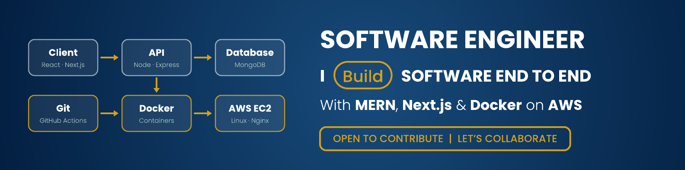

  <picture>
    <source media="(prefers-color-scheme: dark)" srcset="https://readme-typing-svg.herokuapp.com?font=Fira+Code&size=28&duration=3500&pause=500&color=00F0FF&center=true&vCenter=true&width=800&lines=Hi+%F0%9F%91%8B+I'm+Waleed+Ahmed;Software+Engineer+%F0%9F%9B%A0%EF%B8%8F;I+design,+build+and+deploy+full+stack+apps;I+solve+problems+with+DSA+%F0%9F%A7%A0">
    
  </picture>

<h3 align="center">Turning real-world problems into reliable, deployed software</h3>

---

### 👨‍💻 About Me

I'm **Waleed Ahmed**, a **Software Engineering student at Virtual University of Pakistan** (Lahore, Pakistan 🇵🇰).

- 🏗️ I build **complete MERN and Next.js products**: database design, REST APIs, real-time features and polished interfaces
- 🐳 I containerize apps with **Docker** and deploy them on **AWS EC2**
- 🧩 I practice **data structures and algorithms** regularly and have completed the **Blind 75**
- 🚀 About to start my **Final Year Project**

---

### 🧰 Tech Stack

**Languages**

  
  
  

**Frontend**

  
  
  
  

**Backend and Database**

  
  
  
  
  
  
  
  <!--  -->

**DevOps and Tools**

  
  
  
  
  
  
  
  
  
  

---

### 💼 Featured Projects

| Project | What it does | Tech Stack | Links |
|---------|--------------|------------|-------|
| 🎓 **Skillory** | Full stack LMS with expert-led courses, payments and real-time features | Next.js, Node.js, Express, MongoDB, Socket.IO, Cloudinary, Stripe | [Live](https://skillory-topaz.vercel.app) · [Code](https://github.com/devbywaleed/skillory) |
| 🛒 **Zenvio** | Multi-vendor e-commerce marketplace with real-time features and cloud image uploads | React, Node.js, Express, MongoDB, Socket.IO, Cloudinary, Stripe | [Live](https://zenvio-six.vercel.app) · [Code](https://github.com/devbywaleed/e-shop) |
| 🥦 **GreenCart** | Online grocery store with product management, checkout and payments | React, Node.js, Express, MongoDB, Cloudinary, Stripe | [Live](https://grocery-eta-six.vercel.app) · [Code](https://github.com/devbywaleed/greencart) |
| 🐳 **Dockerized MERN on AWS EC2** | Containerized MERN app deployed on EC2 with environment and server setup | Docker, AWS EC2, Linux, Node.js, MongoDB, Supabase | [Live](http://ec2-51-21-182-234.eu-north-1.compute.amazonaws.com:5173) · [Code](https://github.com/devbywaleed/real-estate) |
| 🌐 **Portfolio** | Personal site with case studies for my projects | Next.js, TypeScript, Tailwind CSS | [Live](https://waleed-code.netlify.app) · [Code](https://github.com/devbywaleed/waleed-dev) |

> 📂 Each repository has an architecture diagram in its README. Full case studies are on my [portfolio](https://waleed-code.netlify.app).

---

### 🎯 Currently Focused On

- 🎓 Planning and building my **Final Year Project**
- 🧩 Strengthening **DSA and problem solving** through daily practice
- ☁️ Going deeper into **Docker, AWS and deployment pipelines**
- 🔷 Writing more of my backend and frontend in **TypeScript**

---

### 🧩 Problem Solving

  

- ✅ Completed the **Blind 75**
- 🏆 **LeetCode Capstone Task:** keyword finding plus 4 unseen problems alongside 3 already-solved ones ([View Proof](https://github.com/devByWaleed/leetcode/tree/main/Wiki/CAPSTONE-1))
- 📂 My own solutions: [LeetCode](https://github.com/devByWaleed/leetcode) · [CSES](https://github.com/devByWaleed/CSES)

---

### 📊 GitHub Stats

  
  

---

### 💬 Daily Reminder

  <picture>
    <source media="(prefers-color-scheme: dark)" srcset="https://readme-typing-svg.herokuapp.com?font=Fira+Code&size=22&duration=4000&pause=1000&color=00F0FF&center=true&vCenter=true&width=920&lines=Programming+is+Thinking,+Not+Typing.;Think+First,+Then+Code.;Ship+it,+then+make+it+better.">
    
  </picture>

---

### 🤝 Let's Connect

I'm open to **software engineering opportunities, internships and collaborations**.

📫 Reach me at: **waleeddev91@gmail.com**

  
  
  
  
  
  

---

⭐ If you like my work, consider giving a star to my projects. It motivates me to keep building. 🚀